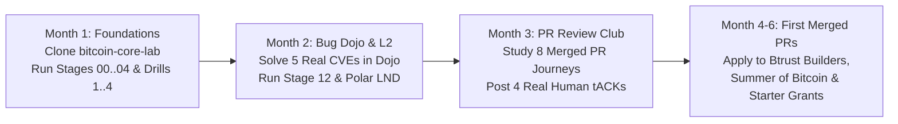

# Btrust Grants, BitDevs Operations & Open-Source Community Blueprint

This playbook summarizes how to stay **100% compliant with Btrust (`btrust.tech`) regulations** while:
1. Earning a **Btrust Grant** (paid in Bitcoin) as an open-source contributor,
2. Operating a **Btrust-compliant BitDevs Socratic Seminar**, and
3. Training local developers in your community using [`bitcoin-core-lab`](file:///Users/mac/bitcoin-core-lab/README.md) so they can also earn from Bitcoin Free and Open-Source Software (FOSS).

---

## Part 1: Btrust's Core Non-Negotiable Rules (The "Red Lines")

Whether you are applying for a personal developer grant or a BitDevs meetup sponsorship, Btrust enforces strict rules:

1. **100% Bitcoin-Only (Zero Altcoins / Zero Web3 / Zero Tokens):**
   - All code, repositories, meetups, and public developer profiles must focus strictly on **Bitcoin** (Layer 1: Bitcoin Core, libsecp256k1, BDK, Floresta, Stratum V2; Layer 2: LND, Core Lightning, LDK, Eclair, Fedimint/Cashu).
   - Promoting altcoins, "blockchain/Web3" tokens, or closed-source commercial products disqualifies an application immediately.
2. **100% Free and Open-Source Software (FOSS):**
   - Every line of code and educational tool must be public under an open-source license (MIT / BSD / Apache 2.0) on GitHub/GitLab.
3. **Public Proof of Work (No Ghost Work, No AI Spam):**
   - Upstream Bitcoin projects (`bitcoin/bitcoin`, `lightningnetwork/lnd`, `lightningdevkit/rust-lightning`, `bitcoindevkit/bdk`) enforce strict human-in-the-loop policies (`doc/AI_POLICY.md`).
   - Btrust evaluates **verifiable public links**: merged PRs, meaningful code reviews (`tACK` / `crACK` / bug catches), issue reproductions, and public monthly progress reports.

---

## Part 2: How to Qualify for a Btrust Developer Grant (Your Personal Track)

Btrust offers three main developer pathways for builders in Africa and the Global South:

### 1. Btrust Builders (Pathway Program)
- **Who it is for:** Experienced software engineers transitioning into Bitcoin & Lightning open-source development.
- **How your lab gives you an edge:** You already have Polar (`Addis Ababa Bootcamp` & `Bitrust Bootcamp 2026`), a compiled `bitcoind` + `test_bitcoin` environment, and 13 stages of pure Bitcoin & Lightning code in [`bitcoin-core-lab`](file:///Users/mac/bitcoin-core-lab/README.md).

### 2. Btrust Starter Grant (6 Months Full-Time, Paid in BTC)
To win a **Btrust Starter Grant**, you must show that you have already started contributing *before* asking for funding. Specifically, Btrust requires:
- **1 Target Project Chosen:** Pick one primary upstream project (e.g., `bitcoin/bitcoin`, `btcsuite/btcd`, `lightningnetwork/lnd`, or `bitcoindevkit/bdk`).
- **Non-Trivial Merged Code PR(s):** At least **one merged code-based PR** (not just typo/doc fixes, and beyond trivial `good first issue` labels).
- **High-Signal Code Reviews (Your Fastest Entry Point):**
  - Btrust explicitly looks for *"evidence of contributing helpful technical insights on other people's work (code reviews)"*.
  - Reviewing 1–2 open PRs per week using [`./lab.sh pr-audit`](file:///Users/mac/bitcoin-core-lab/lab.sh) and the 7 Maintainer Patterns in [`pr-reviews/merged-journeys/README.md`](file:///Users/mac/bitcoin-core-lab/pr-reviews/merged-journeys/README.md) builds a public track record of `tACK`s and bug catches on GitHub.
- **A Clear 6-Month Scope of Work:** A concrete proposal listing what PRs, test coverage, or subsystem improvements you will deliver full-time over 6 months.
- **1 Peer/Contributor Reference:** Once you consistently review a maintainer's or regular contributor's PRs (and fix issues they care about), they know your work and can vouch for you.

### 3. Btrust Open-Source Cohort / Developer Grants (12+ Months, Paid in BTC)
- For established contributors with an ongoing track record of merged PRs and reviews who commit full-time to maintaining and advancing critical Bitcoin infrastructure.

---

## Part 3: How to Operate a Btrust-Sponsored BitDevs Chapter

Btrust sponsors local **BitDevs** chapters across Africa (covering venue, refreshments, and logistics) provided you follow the official **BitDevs Africa / Btrust Meetup Regulations**:

### Rule 1: Co-Organizer Requirement (Never Solo)
- Btrust **does not award BitDevs grants to a solo organizer**.
- You must have **at least 2 committed co-organizers** in your city/location, and **at least one must be an active technical Bitcoin developer** (which is your role).

### Rule 2: Mandatory "Socratic Seminar" Format (No Sales Pitches or Lectures)
- A BitDevs meetup is **not** a beginner "What is Bitcoin?" lecture or a company pitch.
- It must follow the **Socratic Seminar** format:
  1. **1–2 Weeks Before the Meetup:** Publish a public reading list on your BitDevs website/GitHub containing recent **Bitcoin Optech Newsletter** items, **merged & open `bitcoin/bitcoin` PRs** (from your [`pr-reviews/merged-journeys/`](file:///Users/mac/bitcoin-core-lab/pr-reviews/merged-journeys/README.md)), **Delving Bitcoin** threads, and **Lightning BOLT** updates.
  2. **During the Meetup:** As moderator, you briefly introduce each PR or protocol topic in 2 minutes, then ask the room open technical questions (*"Why did `@maflcko` need `sync_mempools()` between `tx1`, `tx2`, and `tx3` in PR #36553?"*, *"What happens if two miners broadcast conflicting compact blocks?"*).

### Rule 3: Strict Chatham House Rule & Zero Recording
- **Chatham House Rule:** Attendees are free to use the technical knowledge shared, but **never attribute who said what** outside the room.
- **No Video Recording / No Live Streaming:** BitDevs Socratic Seminars are **never recorded or live-streamed**, and photography during technical discussions is restricted so developers can speak freely and ask questions without fear.

### Rule 4: Monthly Budget & Attendance Reporting (By the 10th of Each Month)
- Submit your budget prior to the meetup using Btrust's template, track attendance, publish the Socratic Seminar topic list publicly, and submit your Meetup & Finance Report on time every month (typically before the 10th of the following month).

---

## Part 4: How to Build a Local Community of Contributors Who Earn From Open Source

You can use your own [`bitcoin-core-lab`](file:///Users/mac/bitcoin-core-lab/README.md) repository as a **4-Step Incubator** after each monthly BitDevs Socratic Seminar (e.g., running a 2-hour "PR Review Club & Builder Workshop" alongside BitDevs):

### Other Bitcoin Open-Source Grants Your Community Members Can Earn From:
As your BitDevs members build a portfolio of real GitHub reviews and PRs, guide them to apply to:
1. **Btrust Builders & Btrust Starter Grants** (`btrust.tech`) — For African & Global South engineers moving into full-time Bitcoin FOSS.
2. **Summer of Bitcoin** (`summerofbitcoin.org`) — Paid summer internships (in BTC) for university students contributing to Bitcoin Core, LND, BDK, LDK, and Polar.
3. **Spiral Grants** (`spiral.xyz`) — Grants from Block's Bitcoin open-source arm for developers and designers improving Bitcoin usability, LDK, and BDK.
4. **OpenSats** (`opensats.org`) — 100% pass-through Bitcoin grants for open-source contributors working on Bitcoin Core, Nostr, and Lightning infrastructure.
5. **Brink** (`brink.dev`) & **Maelstrom Bitcoin Grant Program** — Fellowships and grants for Bitcoin Core protocol developers and reviewers.
